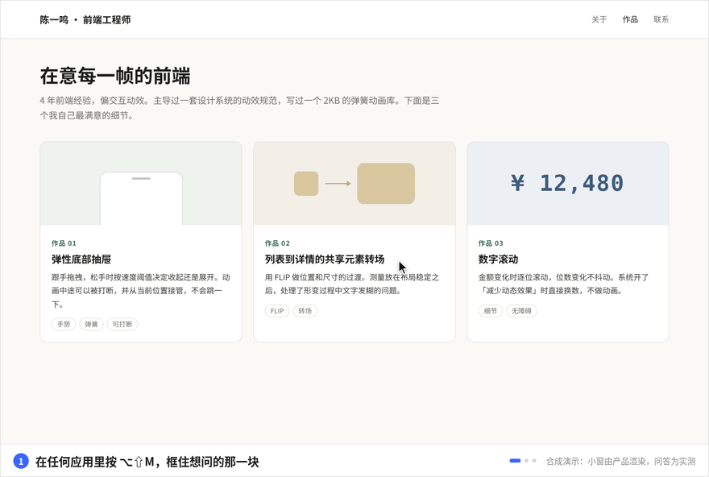

# DSH-projects

**Your next agent product doesn't need you to worry about agents. Exploring the best way for people and AI to work together.**

[中文](README.md)

Do you keep switching between sessions, and does setting up each agent give you a headache? Do you wish you could keep a large number of agent conversations in hand without carrying context back and forth yourself?

If you are also looking for a better way to manage context, DSH-projects wants to offer the next way for people and AI to work together: hide every detail that isn't needed, let people focus on what really matters, and bring down the cost of working with AI.

This is the core philosophy DSH-projects is built on, and its main difference from similar agent products:

**1. Organise context around the nature of the task itself. Managing multiple agents is a false problem; the only thing that needs managing is context.**

- At bottom, multiple agents are context isolation. Splitting work across several agents in parallel is only worth it when the task can be decomposed and its subtasks have no sequential dependencies; otherwise coordination overhead and error amplification eat the gain, and what is left is a shallow imitation of a human meeting room.
- What really improves how well a task gets done is not agents reviewing each other. It is deliberately keeping a Goal/Loop document on every run, stating the goal, what counts as done and the progress so far; without it, the AI's goal drifts over a long task and it wanders off on its own.
- Given a task's goal and its rules, the coordinator can work out by itself which model to use, which Skills to load and which permissions to grant. An agent is only one temporary session of a task, and when you need parallel work you can still open several sessions at the task level; making people hand out Skills, permissions and runtime agent by agent is an extra burden. We think the only difference a user needs to perceive is the model.

**2. Take in as much context as possible, and free people from the chore of organising it.**

- DSH-projects builds on the open-source project screenpipe and can collect information from every channel on your machine, help you draft email replies, and think what you are thinking.
- Wherever you are, you don't carry context around and you don't worry about environments, files or opening new conversations. The personal assistant organises and assigns the context for you.


Left: a common multi-agent product, where context, Skills and runtime are bound into each agent. Right: DSH-projects, where one personal assistant serves many projects, each project is split into tasks along context boundaries, and the runtime is decoupled from the context and can be swapped per task. The numbers refer to the sections of the [architecture article](https://hovocope135-tech.github.io/DSH-projects/site/blog/en/deep/). The figure's labels are in Chinese.

**Install DSH-projects and try it.**

## Getting started

> npm's `preview.1` is still the previous interface. For the version in the pictures, use the "Install from source" lines.

You need DeepSeek Harness (`npm install -g @deepseek-ai/dsh`, tested on 0.2.1), Node 24 or later and an API key for your model. The interface is in Chinese for now.

```sh
dsh plugin --profile web add deepseek-harness-projects-plugin@preview
dsh --profile web        # start it and open the address it prints
```

<details>
<summary>Install from source</summary>

```sh
git clone https://github.com/hovocope135-tech/DSH-projects
cd DSH-projects/plugin
dsh plugin --profile web add "$(pwd)"    # add the plugin to DeepSeek Harness
dsh --profile web
```

</details>

Detailed steps are in the [guide](docs/GETTING-STARTED.en.md).

### 1. Set up your assistant

On first open, a dialog titled **捏一个你的助理** (make your assistant) lets you pick a look and traits, give it a name, and choose a shortcut that calls it up. It is called Tacit by default.


### 2. Hand everything to your personal assistant

In DSH-projects we encourage you to bring every request straight to the personal assistant. Tell it what you need, and it turns your request into a project and creates that project by itself:

> We're hiring a front-end engineer who leans towards interaction and motion. Create a project 「前端招聘」 and start with two things: write a second-interview question set interview.md, three questions on motion and interaction details, each with scoring notes; then build a hiring page jobs.html that can go on the website.


A finished task shows up under **待你决定** (waiting on you) on the right, for you to accept.

### 3. Manage tasks inside a project

Each task has its own long-lived context. Open a task, and **任务详情** (task detail) on the right holds the background with your own words, the output, the progress, what counts as done, and which model the task uses.


Delivered files open right in **交付** (delivery): click **验收通过** to accept, or **请求修改** to ask for changes.

### 4. Keep working: context keeps accumulating, and your assistant understands you better and better

**Computer History** turns what you do on your computer into a timeline: one entry per 10 minutes, saying what you were doing and which apps you used. It needs Screenpipe on your machine and is turned on under **活动与设备** (activity and devices) in **助理设置** (assistant settings). After that you can simply ask:

> 用一张可视化的图，展现我今天做了什么 (show me what I did today as a picture)


It answers in text first; reply 「做成一页网页」 (make it a web page) and what comes back is the page in the picture.

### 5. Come back later

Before you go offline, tell Tacit what to do:

> I'm going offline and will check in the morning. Finish these three things overnight: an English version of the hiring page, jobs-en.html; a job description for the hiring site, jd.md; and a note on the interview process, process.md, saying what the first, second and final interviews each look at.


When you come back, look at **待你决定** on the right: **项目进展** (project progress) says where each project stands and what waits for your acceptance, and **新消息与建议** (messages and suggestions) holds what it left for you overnight.

### 6. Frame a piece of the screen and ask

In any app, press ⌥⇧M, frame a piece of the screen, and ask in the small window that opens; the answer appears in the same window. macOS only for now, and the helper is not in this repository yet.



## Reference

**What you can tell Tacit:**

| You say | What it does |
| --- | --- |
| "Make me a project: hiring a front-end engineer" | Creates a project |
| "Give this to the hiring project: …" | Hands your own words to the project as written, which opens a task |
| "What's waiting for me?" "What happened today?" | Answers from the board and the timeline, each item with its source |
| "Tell the interview-questions task to add a CSS question" | Passes the message to that task |
| "Accept it" | Tells you what changed first, and accepts after you reply "confirm" |
| "Remember: I like to read the conclusion first" | Adds it to About you, with your words |
| "Use a cheaper model for this project from now on" | Records it as the project's model strategy, then switches models accordingly |

It doesn't send messages in your name. Without a word from you it makes no decision and accepts nothing.

## More thinking

- [Your next agent product doesn't need you to worry about agents](https://hovocope135-tech.github.io/DSH-projects/site/blog/en/)
- [Architecture: Managing agents is managing context](https://hovocope135-tech.github.io/DSH-projects/site/blog/en/deep/)

## Where it stands

Version 1.0. It runs only inside DeepSeek Harness, the interface is in Chinese for now, and Feishu is read-only. Claude Code as an executor has been run for real. Codex can be selected, but a complete task run on it has not been verified yet. Both run without permission prompts or a sandbox: they can read and write whatever your OS user can.

License: [MIT](LICENSE).
