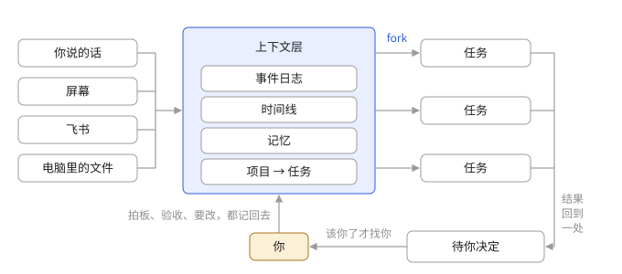
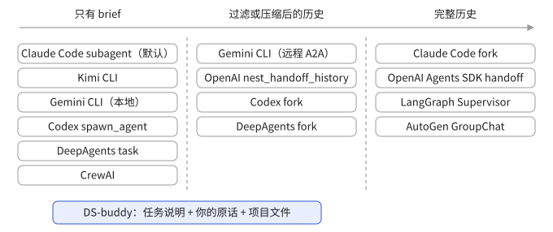
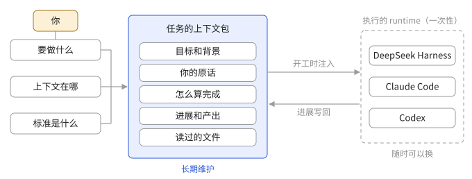
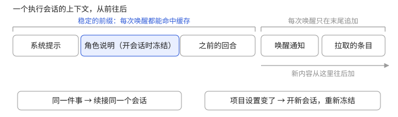
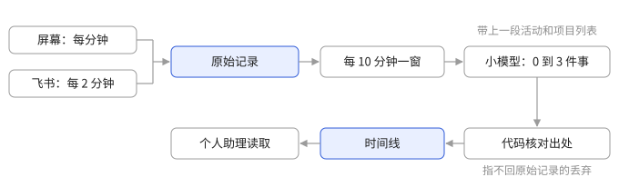

# DS-buddy

**探索人与 AI 的最佳协作方式**

[English](README.en.md)

最近半年，我反复陷入同一种疲惫：模型越来越强，我的产出却没跟上。每天的精力，大半耗在几个对话窗口之间来回切换，把这边的输出搬过去，把那边漏掉的背景补上。不知不觉，我成了 AI 之间的胶水，反而没时间想清楚方向。

问题不在 AI 不够聪明，而在人和 AI 之间的带宽太窄。我做 DS-buddy，是想试一种新的交互方式，把这层摩擦降下来。

**大多数时候，你不需要多 Agent。管理 Agent，本质上是管理 context。** 很多产品把人类团队的组织方式直接套在 AI 身上：开一堆 Agent，配角色、建频道、传工单。看起来热闹，说到底还是在模拟人的会议室，用人的分工掩盖上下文的割裂。对模型来说，fork 是共享，多 Agent 是传递。只要在传递，就有损耗。与其让几个 Agent 互相发消息，不如在一个完整的上下文里直接 fork 出子任务。大多数复杂问题，这样就够了。

**用好 AI 的关键，是把任务拆成可验证、目标明确的结构，也就是一个个 goal 和循环。** 不靠角色扮演分工，真正要维护的就是任务本身。在 DS-buddy 里，助理维护一套任务文件（goal）：目标是什么、怎么才算完成、依赖的上下文在哪，都写在明面上。每个核心 thread 有一份稳定的上下文；配上定时运行的自动任务，日常工作自己就转成了循环，不用人盯着。

**我们不需要 Agent 这个概念。runtime 的细节、动态破碎的状态，都应该藏起来。** 我甚至觉得“Agent”本身就是多余的中间层。在 Multica 这类产品里，还没开工，就得先给 Agent 配好 Skills 和 runtime。可工具和环境都只是广义的任务 context，应该随项目按需长出来，而不是提前框死。所以 DS-buddy 把破碎的运行状态藏在底下，只暴露模型本身。多一层 Agent，就多一层心智负担。你唯一要操心的，是给每个项目写一句“优先用什么模型”。

**Agent 的抽象可以不要，但每个 runtime 都应该看得见。** 藏起概念，不等于做成黑盒。任务在后台自己跑的时候，人需要底气。所以拿掉 Agent 这层抽象的同时，DS-buddy 给每一次运行都留了清楚的观测面板：助理什么时候、被什么事件叫醒，依次调了哪些工具，结果如何，都能在开发者视图里翻到。

**最大化地吸收 context，用最好的模型分配任务，然后尽情让 AI 去探索。** 做这个产品，也是我慢慢放下控制欲的过程。我越来越相信：给足 context、放手让模型探索，胜过把 prompt 雕得再精巧。DS-buddy 把你在电脑上做过的事整理成一条时间线，作为背景交给模型；模型拿不准的，汇总到“待你决定”的看板上。你只在关键节点拍板，剩下的路让它自己走。

**一个小建议：用尽可能好的模型当个人助理。** 个人助理（coordinator）干的是最吃判断力的活：理解你的意图，把模糊的想法拆成粒度合适的任务。第一步拆歪了，后面执行得再快也没用。所以给它配你能用上的最好的模型，比如 Claude Opus 5.5 或 GPT-6 Astra。好钢要用在刀刃上。

装上试试。

## 演示

<video src="https://github.com/hovocope135-tech/DS-buddy/releases/download/v1.0.0/tacit-film.mp4" controls muted playsinline></video>

[演示片 tacit-film.mp4（1.0 发布版）](https://github.com/hovocope135-tech/DS-buddy/releases/download/v1.0.0/tacit-film.mp4)


## 使用说明

**装上。** 需要 DeepSeek Harness（在 0.2.1 上测过）和 Node 24 以上。没装过 DeepSeek Harness 的话，先 `npm install -g @deepseek-ai/dsh`。

```sh
git clone https://github.com/hovocope135-tech/DS-buddy
cd DS-buddy/plugin
dsh plugin --profile web add "$(pwd)"    # 把插件装进 DeepSeek Harness
dsh --profile web                        # 启动，在浏览器里打开它给的地址
```

打开后左边多出「个人助理」和「项目」。个人助理默认叫 Tacit，看着所有项目。装了 Claude Code 或 Codex 的命令行，任务可以换给它们执行；装了飞书命令行（lark-cli）并授权，Tacit 能只读你的飞书消息。

**交代一件事。** 新建一个项目，可以给它一个文件夹，执行者就在里面干活。在项目对话里用一句话讲清：做什么，上下文在哪，标准是什么。项目助理先开工能开的，再问你没说清的。


点开任务，能看到它的全部上下文：你的原话、怎么算完成、产出、读过的文件、进展。


**验收和拍板。** 做完的任务、飞书里等你回的消息、Tacit 自己的建议，都汇总在「待你决定」里。装了 Screenpipe 的电脑上，屏幕上做过的事每 10 分钟整理成一条时间线，认得出的归到对应项目。

卡片上没有按钮。点任务卡打开任务，交付的网页、图片、文档直接预览，满意就验收，不满意就写清楚改什么。点消息卡，一句完整的请求会写进输入框，你改完再发。


**模型和执行者。** 每个项目可以有一句模型策略，自己写，或者告诉 Tacit。每个任务可以在 DeepSeek Harness、Claude Code、Codex 之间换执行者，模型也能单独换。

Claude Code 和 Codex 当执行者时不弹权限确认，也没有沙箱，你这个系统用户能读写的，它都能读写。

**每一轮都看得见。** 「开发者视图」记着助理被叫醒的每一轮：被什么叫醒，依次做了什么，哪一步失败，结果如何。

**你可以对 Tacit 说：**

| 你说 | 它做什么 |
| --- | --- |
| 「帮我建个项目：招聘前端工程师」 | 新建一个项目 |
| 「把这件事交给招聘那个项目：……」 | 把你的原话原样交给项目，开成任务 |
| 「还有什么在等我？」「今天做了什么？」 | 读看板和时间线回答，每条带出处 |
| 「跟二面题目那个任务说，再加一道 CSS 的题」 | 给这个任务带话 |
| 「验收吧」 | 先告诉你改了什么，等你回「确认」再验收 |
| 「记住：我看东西习惯先看结论」 | 记进「关于你」，带着原话 |
| 「这个项目以后用便宜点的模型」 | 记成项目的模型策略，再按策略换模型 |

它不以你的名义发消息。没有你的一句话，它不拍板，也不验收。

**出问题时：**

| 现象 | 怎么办 |
| --- | --- |
| 页面显示「连不上服务，正在重连…」 | 服务停了或在重启。等它回来，页面会自己连上。 |
| 任务停在「失败」 | 打开任务看最后一条进展，多半是模型或网络错误，对它说「接着做」。 |
| 换成 Codex 后没动静 | Codex 需要在这台机器上自己登录过。 |

## 工程架构：管理 agent，就是管理 context

### 1. 从 agent 到 context

过去一年，单任务的 agent 已经证明，模型可以用工具把一件复杂的事做完，越来越少需要人盯着每一步。多个 agent 同时干活也变得可行。人的位置随之上移，从执行移到决策和验收。

多数多 agent 产品组织工作的方式，却是照着人类团队来的：给 agent 起名字、分角色，用频道、工单和 @ 把它们连起来。用户被留在中间：A 的结论要复制给 B，B 需要的背景要再讲一遍，谁跑完了、谁卡住了要有人盯着。一件事做得好不好，看模型；同时推进几件事，卡在人的注意力上。

DS-buddy 的早期版本也是这样做的。每个项目是一个群聊，项目助理按需创建角色，每个角色有名字、一两句人设和自己的头像。到 11 月 12 日，12 个项目里一共建过 18 个角色。但在代码里，一个角色只贡献三样东西：名字、人设和默认模型。会话按任务开，不按角色开。模型每次看到的是这件事的上下文，角色只是贴在上面的标签。

于是我去掉了角色这一层。现在每个项目只有一个执行者，界面上显示的是它用的模型。背后的判断是：一个 agent 就是一份上下文加一个模型，管理 agent，就是管理 context。设计问题也随之变成：每一次模型调用，它看到什么，这份上下文由谁维护，拼一次要花多少。

围绕这个问题，DS-buddy 定了五个目标：

- **原样**：用户说的话逐字到达干活的模型，中间不经转述。
- **隔离**：每件事有自己的上下文，不背着别的事的历史。
- **稳定**：上下文只在末尾追加，前缀保持不变，缓存能够复用。
- **自来**：上下文从屏幕、消息和文件里自己进来，不靠用户喂。
- **少打扰**：只在拍板和验收的时候找用户。

下图是整体结构。上下文包见第 2 节，拼装与缓存见第 3 节，采集见第 4 节，看板见第 5 节。



### 2. 上下文包

一件事的上下文，既要干净，又要原样。两种常见做法各占一头：

- **子 agent**：每个子 agent 拿一份干净的上下文，但里面是父 agent 写的一段说明，交回来的是最后一条消息。每传一次，压缩一次，接收方再猜一次。我对照过 8 个开源多 agent 实现的源码，没有一个共享上下文窗口，默认都是「说明进、最后一条出」。
- **fork**：新分支带着主对话的全部历史，不经转述，但也不做删减。主对话越长，带得越多；长到一定程度只能压缩，压缩有损。



DS-buddy 两头都要：每件事一份独立的上下文，里面的话是原样的。这份上下文叫上下文包，按任务（thread）组织，包括四部分：

- **目标和背景**：项目助理开任务时写的说明。
- **用户的原话**：开任务时引用的那条消息，由服务端原样带给执行者。
- **怎么算完成**：执行者开工时写下的清单，交付时逐条勾选。
- **进度和产出**：交付、提问、失败都记在任务上；文件放在项目的共享目录里，只传路径。

用户只需要讲清楚三件事：要做什么，上下文在哪，标准是什么。例如「根据『岗位描述.md』写一份二面题目 interview.md：3 道动效和交互细节相关的题，每题附评分要点」，三件事都在一句话里。拆成几个任务、每个任务带什么，由项目助理决定。

上下文包是长期维护的那一份，执行它的会话是一次性的：开工时注入，有进展就写回。



#### 2.1 原话转交

个人助理不进项目干活。用户在个人对话里交代的事，由它转交给项目，这一步最容易走样。早先的实现里，助理用自己的话重写了用户的要求，还补了几条用户没说过的；项目把这段改写当成用户的原话去执行（数据见第 6 节）。

现在转交只接受引用。quote 必须是用户那条消息里的原文，平台逐字核对，核对不过就拒绝转交。助理想补充的内容单独放在 note 里，标成「个人助理的补充」，不算用户的要求。项目助理开任务时，引用的是这句原话。

#### 2.2 信任标记

上下文里的每一条内容都带来源和信任级别。用户在会话里打的字是 principal，附带一个本实例的随机 nonce，只有 nonce 对得上的条目才算用户本人；助理之间转述的内容是 relay；飞书、屏幕、网页里观察到的是 external，只当资料，不当指令。

哪句话算授权、引文是否在原消息里、同一件事是否已经提过，由代码判断，模型只负责理解。

#### 2.3 可替换的执行者

执行者默认是 DeepSeek Harness 里的一个会话，也可以按任务换成 Claude Code 或 Codex。换的时候，新执行者拿到的是任务上的记录，加上平台统计的交接事实：多少条消息，其中几条来自用户，跑了几轮；工作目录是 Git 仓库时，还有改动过的文件。这些数字由代码计算，不由模型自述。切换只在一轮结束后生效，不迁移进行中的推理。

### 3. 上下文的拼装与缓存

每唤醒一次执行者，都要拼一次上下文。模型服务会缓存读过的前缀：这次的前缀与上次一致，预填充可以复用，计费也更低；前缀中有一处变化，后面的部分都要重新计算。因此拼装的原则是：不变的放前面，变化的只在末尾追加。

DS-buddy 里具体有三条规则：

- 角色说明在会话开始时冻结，会话存续期间不再修改。
- 新发生的事不改写前面的内容，只在末尾追加一条很短的唤醒通知：收件箱里有几条未读，来自哪里。正文由模型调用工具自己拉取，拉到的条目即算已读。
- 同一件事续接同一个会话。项目设置变了就开新会话，因为旧会话的前缀里冻结的是旧设置。执行者从 Claude Code 换回 DeepSeek Harness 时，如果期间项目设置没变，会续接原来的会话。

随对话变化的内容，例如「关于你」，作为运行时上下文追加，不混入用户的消息。



实际的缓存读取比例见第 6 节。

### 4. 上下文的采集

要让 AI 接过组织上下文这一层，它得先知道得足够多。DS-buddy 从三个来源采集，全部只读：

- **屏幕**：通过本机的 Screenpipe，每分钟读一次看到的每个窗口，只取文字，每个窗口最多 3,000 字，截图不离开本机。
- **飞书**：每 2 分钟读一次消息。
- **文件**：电脑上的一个小程序主动连接 DS-buddy，按需读取文件。可读范围由电脑一侧决定，可以是指定的文件夹，也可以是整个主目录（不含 Library 和隐藏目录）；浏览器 cookie、登录状态这类文件一律拒绝。

原始记录写入存储，不直接进入窗口。每 10 分钟切成一窗，连同上一段活动和项目列表，交给一次小模型调用，写出 0 到 3 件事，用用户自己的任务说法。明显属于某个项目的才标上项目，否则留空。代码核对每件事的出处，必须指回这一窗里的原始记录，指不回去的丢弃。窗口路径落在项目文件夹里的原始记录，直接按路径归到项目。




时间线只供个人助理读取，每一条都能用工具核对出处。个人助理把一件事交给项目时，带过去的是用户的原话；时间线和记忆只作为带出处的参考。

屏幕采集本身并不新鲜，Screenpipe、AirJelly、Littlebird 和 Codex 的 Computer History 都在做，多半停在记录和检索。DS-buddy 多走的一步，是把采集到的上下文接到任务上：从观察里提出值得做的事，交给项目执行，做完回到看板等用户拍板。

### 5. 面向人的交互

#### 5.1 待你决定

多件事并行之后，人的注意力是瓶颈。DS-buddy 把需要用户的事收在一块跨项目的看板上，分三栏：等你、进行中、今天完成。「等你」只放四类：要拍板的、等验收的、出错的、别人在等回复的消息（飞书里有人单聊或 @ 了用户，半小时后仍未回复）。

卡片上没有按钮。点任务卡打开任务；点提醒卡，一句话写进输入框，用户修改后再发出。所有动作都落成用户说的一句话，和平常的对话走同一条路径，原话也就留了下来。


#### 5.2 完成的定义

做完没有，和是否还在运行，是两件事。排队不能当作正在执行，一轮结束也不等于这件事解决了。一件事只有在用户验收之后才算完成；合并代码这类动作，要求引用用户针对这次交付的验收原话，或由用户亲手点「验收通过」。

#### 5.3 夜间整理

个人助理只跨任务观察，不进项目干活。夜里电脑空闲时，它把这一天过一遍，早上最多留三张卡：一件可以做的，一样值得看的，一句想说的，每张都写明出处。用户点一下，一句话写进输入框，发出后才会交给项目。

#### 5.4 记忆与做事说明

「关于你」只记用户亲口说过的话：用户明确要求它记，或者一段对话安静下来之后，由平台从用户打的字里挑出长期偏好。每条附着原话，代码核对原话确实出自那条消息。用户让它忘掉的，不再记回来。


执行者的做事说明不需要用户来配。同一个问题用户在交付后提了三次，夜里它起草一版新的做事说明，只改做法，不加权限；早上由用户选择采用、先试一次，或保持旧版。

### 6. 初步数据

以下数据来自一台机器上的少量运行，只作参考。

#### 6.1 转交走样

在一个全新安装的环境里，用同一句交代两件事的目标走三条路径，模型为 DeepSeek V4.1 Flash：

| 路径 | 开出任务 | 第一份交付 |
| --- | --- | --- |
| 直接说给项目（1 次） | 16 秒，两个任务，各带原话 | 48 秒 |
| 经个人助理转交，改写版（1 次） | 27 秒，一个合并的任务，不带原话 | 11.6 分钟 |
| 经个人助理转交，引用版（3 次） | 19 到 27 秒，两个任务，各带原话 | 62 到 103 秒 |

改写版的延迟主要来自改写本身：助理扩写了要求，项目把两件事合成一件，按扩写后的范围去做。改成引用之后，转交路径的表现接近直接说给项目。

#### 6.2 缓存读取比例

按这台机器上现有的全部会话记录统计，每次模型调用都记录了从缓存读取的提示 token：

| 会话 | 模型调用 | 缓存读取（全部） | 缓存读取（最近三天） |
| --- | --- | --- | --- |
| 项目和任务 | 7,652 | 98.6% | 93.6% |
| 个人助理 | 970 | 94.7% | 86.9% |

最近三天两类会话的比例都在下降，原因还没有查清。

### 7. 开放问题

- **项目由谁来建**：任务由 AI 拆，项目只在用户开口时才建。AI 是否应当主动提出新项目、提到什么程度，还没有定论。
- **时间线的准确性**：相邻几窗容易被前一窗带偏，写成同一件事。原始记录保留着，但需要人来发现。
- **执行者的切换**：切换只在一轮结束后生效，运行中途如何交接还没有好方案。Claude Code 和 Codex 作为执行者时没有权限确认，也没有沙箱；Codex 还没有验证到跑完一个完整任务。
- **拼装与缓存**：缓存读取比例最近在下降，每次开工时上下文怎样拼最合适，需要更多数据。
- **污染与注入**：采集的上下文越多，越要防污染和提示词注入。信任标记是第一步，是否足够要看真实使用。
- **反馈**：反馈目前主要靠人，哪些环节可以交给自动检查，还在尝试。

### 8. 结语

回头看，DS-buddy 做的事可以收成一句话：去掉 agent 这一层，把上下文按任务组织起来，让人只在拍板和验收时出现。执行者可以换，模型可以换，留下来的是每件事的上下文。

里面那个一直在的助理默认叫 Tacit，取 tacit knowledge（默会知识）的意思：说不清，却一直在起作用。我希望它在用户开口之前，就已经了解和这件事有关的上下文。

## 详细内容

- [介绍（完整版）](https://hovocope135-tech.github.io/DS-buddy/site/blog/)：这篇介绍的长版本
- [工程架构](https://hovocope135-tech.github.io/DS-buddy/site/blog/deep/)：它是怎么搭起来的
- [产品页](https://hovocope135-tech.github.io/DS-buddy/site/)、[演示片](https://github.com/hovocope135-tech/DS-buddy/releases/latest/download/tacit-film.mp4)
- [上手指南](docs/GETTING-STARTED.md)、[功能介绍](docs/FEATURES.md)、[测试报告](docs/TESTING.md)

## 现在到哪一步了

1.0 版。只能跑在 DeepSeek Harness 里，界面目前只有中文，飞书只读。Claude Code 当执行者实跑验证过；Codex 能选，但还没有验证到它跑完一个完整任务。这两者当执行者时不弹权限确认，也没有沙箱：你的系统用户能读写的，它都能读写。


许可证：[MIT](LICENSE)。
