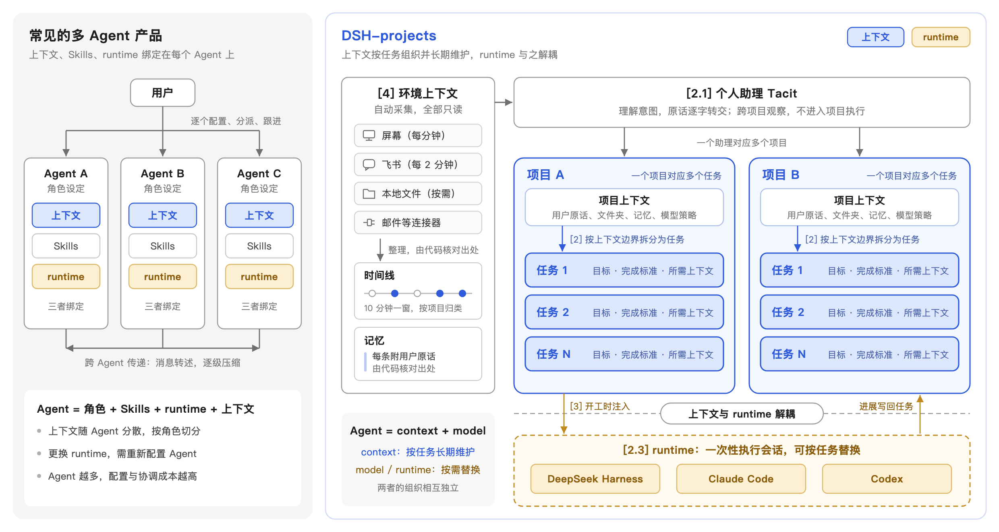

# DSH-projects

**你的下一个 Agent 产品，不需要你操心 Agent。探索人与 AI 的最佳协作方式。**

[English](README.en.md)

你是否也经常在各个Session间反复切换，为配置各个agent感觉头疼？你是否也希望能够管理好大量的agent对话，而不需要自己来回搬运上下文？

如果你也希望探索更好的context管理方式，DSH-projects希望提供下一代的人机协作模式，隐藏所有不必要的细节，让人focus在真正重要的事情上，降低人机协作的成本。

以下是DSH-projects构建的核心哲学，也是和其他同类agent产品的最主要差异：

**1. 一切围绕任务本身的属性去组织context，管理多agent是伪命题，真正需要管理的只有context**

- 多agent的本质是上下文隔离：只有任务可分解、子任务之间没有顺序依赖时，才值得拆给多个agent并行；否则协调开销和错误放大会吃掉收益，沦为对人类会议室的肤浅模拟。
- 比起让agent互相审查，真正提升执行效果的，是每次执行都有意识地维护一份Goal/Loop文档，写清目标、完成标准和进展，否则AI会在长任务里目标漂移，自己发散掉。
- 有了任务的目标和规范，coordinator自然知道该用哪个model、加载哪些Skills、放开哪些权限。agent只是任务的一次临时Session，需要并行时仍然可以在任务层级开启多个Session；让人逐个去分配Skills、权限和runtime是额外的负担。我们认为，用户只需要感知model的差异就足够了。

**2. 最大化吸收 context，把人从整理上下文的杂活里解放出来**

- DSH-projects基于开源项目screenpipe，能够收集本地各个渠道的信息，帮助你起草邮件回复，做到真正想你所想
- 随时随地不用你搬运context，不需要操心环境、文件、开启新对话，个人助理会自己帮你把上下文组织和分配好



左：常见的多 Agent 产品，上下文、Skills 和 runtime 绑定在每个 Agent 上。右：DSH-projects，一个个人助理对应多个项目，每个项目按上下文边界拆分为多个任务；runtime 与上下文解耦，可按任务替换。标号对应[工程架构一文](https://hovocope135-tech.github.io/DSH-projects/site/blog/deep/)的章节。

**快安装DSH-projects试试看吧!**

## 上手

> npm 上的 `preview.1` 还是上一版界面。想要图里这一版，用「想从源码装」那几行。

需要 DeepSeek Harness（`npm install -g @deepseek-ai/dsh`，在 0.2.1 上测过）、Node 24 以上和模型的 API key。

```sh
dsh plugin --profile web add deepseek-harness-projects-plugin@preview
dsh --profile web        # 启动，在浏览器里打开它给的地址
```

<details>
<summary>想从源码装</summary>

```sh
git clone https://github.com/hovocope135-tech/DSH-projects
cd DSH-projects/plugin
dsh plugin --profile web add "$(pwd)"    # 把插件装进 DeepSeek Harness
dsh --profile web
```

</details>

详细步骤见[上手指南](docs/GETTING-STARTED.md)。

### 1. 快速配置助理

第一次打开，跟着**捏一个你的助理**选样子和性格，起名字，定一个呼出它的快捷键。它默认叫 Tacit。


### 2. 一切都交给你的私人助理！

在DSH-projects中，我们鼓励一切需求都直接通过和个人助理对话，向个人助理直接阐述你的需求，个人助理会自己把你的需求拆分为项目，创立新项目：

> 我们要招一名偏交互动效的前端工程师。帮我建个项目「前端招聘」，先做两件事：写一份二面题目 interview.md，出 3 道动效和交互细节的题，每题附评分要点；再做一个能挂到官网的招聘页 jobs.html。


任务做完，会出现在右侧的**待你决定**里，等你验收。

### 3. 在项目中，开始任务的管理

每个任务都有自己的一份长期上下文。点开任务，右侧的**任务详情**里是背景和你的原话、产出、进展、完成标准，以及这个任务用哪个模型。


交付的文件在**交付**里直接看：没问题点**验收通过**，要改点**请求修改**。

### 4. 持续工作，上下文不断累积，你的个人助理将越来越懂你

**电脑活动记录**（Computer History）把你在电脑上做过的事整理成一条时间线：每 10 分钟一段，写明在做什么、用了哪些应用。需要本机装有 Screenpipe，在**助理设置**的**活动与设备**里开启，之后可以直接问：

> 用一张可视化的图，展现我今天做了什么


它把这件事交给项目，交回来的就是图里这一张。

### 5. 再次回来

下线前把要做的事交代给 Tacit：

> 我先下线了，明早回来验收。夜里把这三件事做完：把招聘页出一版英文的 jobs-en.html；写一份发在招聘网站上的职位文案 jd.md；整理一份面试流程说明 process.md，写清一面、二面、终面各看什么。


回来时看右侧的**待你决定**：**项目进展**写着每个项目到哪了、哪些等你验收，**新消息与建议**是它夜里留给你的几条。

### 6. 截一块屏幕，直接问

在任何应用里按 ⌥⇧M，框住屏幕上的一块，在弹出的小窗里问一句，回答就显示在小窗里。目前只支持 macOS，小助手还没有放进这个仓库。


## 使用说明

**你可以对 Tacit 说：**

| 你说 | 它做什么 |
| --- | --- |
| 「帮我建个项目：招聘前端工程师」 | 新建一个项目 |
| 「把这件事交给招聘那个项目：……」 | 把你的原话原样交给项目，开成任务 |
| 「还有什么在等我？」「今天做了什么？」 | 读看板和时间线回答，每条带出处 |
| 「跟二面题目那个任务说，再加一道 CSS 的题」 | 给这个任务带话 |
| 「验收吧」 | 先告诉你改了什么，等你回「确认」再验收 |
| 「记住：我看东西习惯先看结论」 | 记进「关于你」，带着原话 |
| 「这个项目以后用便宜点的模型」 | 记成项目的模型策略，再按策略换模型 |

它不以你的名义发消息。没有你的一句话，它不拍板，也不验收。

## 更多思考

- [你的下一个 Agent 产品，不需要你操心 Agent](https://hovocope135-tech.github.io/DSH-projects/site/blog/)
- [工程架构：管理 agent，就是管理 context](https://hovocope135-tech.github.io/DSH-projects/site/blog/deep/)

## 现在到哪一步了

1.0 版。只能跑在 DeepSeek Harness 里，界面目前只有中文，飞书只读。Claude Code 当执行者实跑验证过；Codex 能选，但还没有验证到它跑完一个完整任务。这两者当执行者时不弹权限确认，也没有沙箱：你的系统用户能读写的，它都能读写。

许可证：[MIT](LICENSE)。
