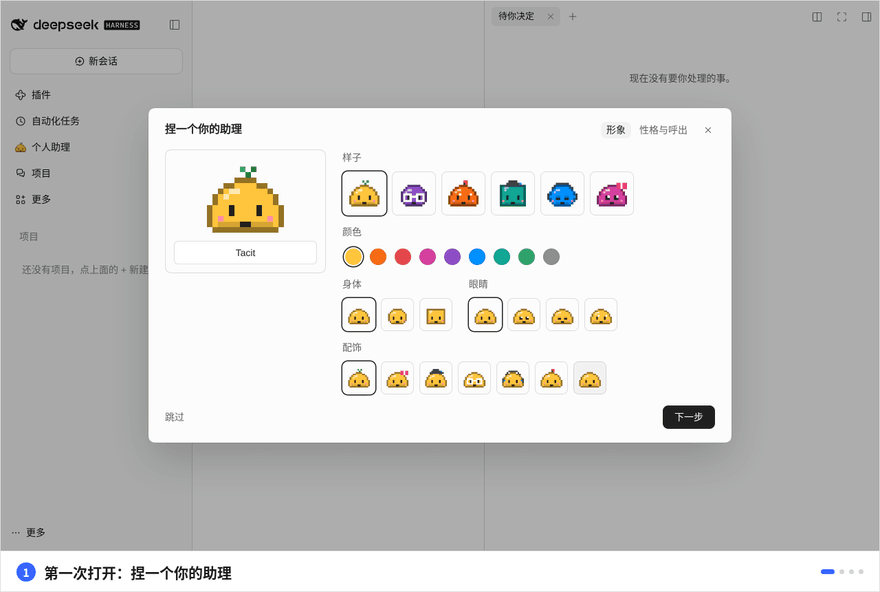
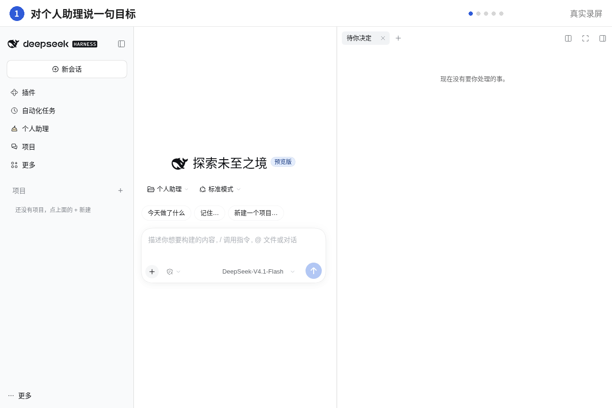
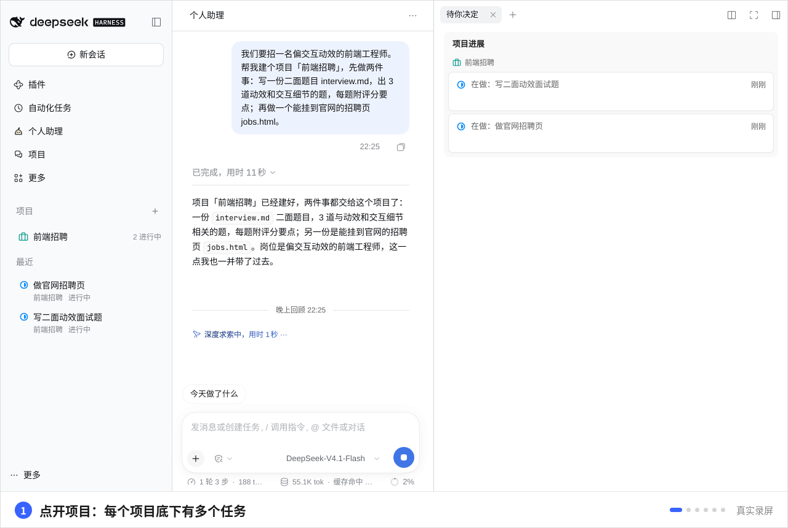
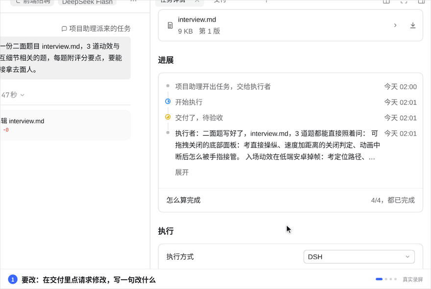
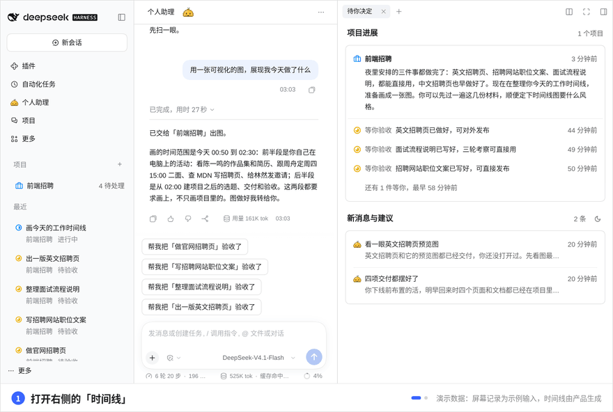
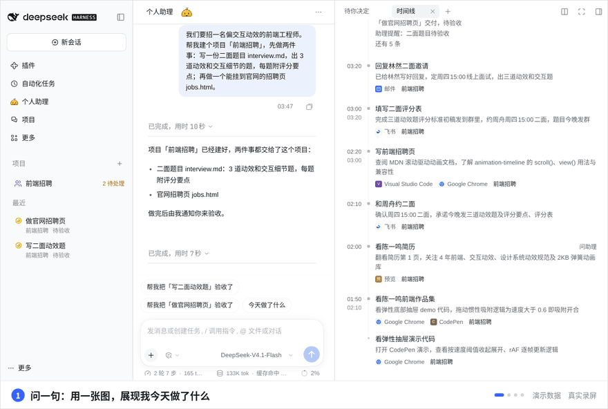
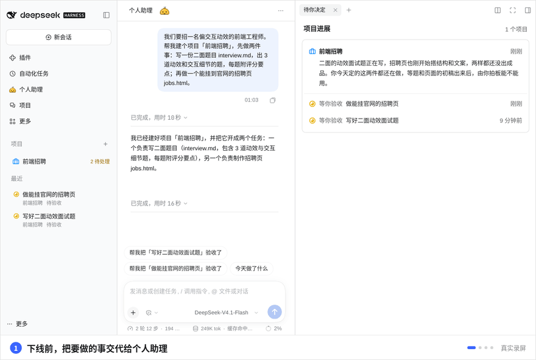
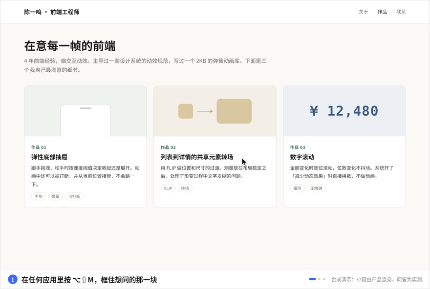

# DSH-projects

**你的下一个 Agent 产品，不一定需要有 Agent。探索人与 AI 的最佳协作方式。**

[English](README.en.md)

你是否也经常在各个Session间反复切换，为配置各个agent感觉头疼？你是否也希望能够管理好大量的agent对话，而不需要自己来回搬运上下文？

如果你也希望探索更好的context管理方式，DSH-projects希望提供下一代的人机协作模式，隐藏所有不必要的细节，让人focus在真正重要的事情上，降低人机协作的成本。

以下是DSH-projects构建的核心哲学，也是和其他同类agent产品的最主要差异：

**1. 一切围绕任务本身的属性去组织context，管理多agent是伪命题，真正需要管理的只有context**

- 只有当任务本质上需要拆分的时候，我们才需要多agent、不同的context，不然多agent只是沦为肤浅的对人类会议室的模拟，相比于肤浅的对抗性审查，真正能够提升任务执行效果的，是从一开始就维护好任务的Goal文档
- 多agent仍然有价值，但是我们不需要agent的概念，在DSH-projects中，你仍然可以在任务层级开启多个Session并行，但是我们不会过度强调agent的概念，我们认为，用户只需要感知model的差异就足够了

**2. 最大化吸收 context，把人从整理上下文的杂活里解放出来**

- DSH-projects基于开源项目screenpipe，能够收集本地各个渠道的信息，帮助你起草邮件回复，做到真正想你所想
- 随时随地不用你搬运context，不需要操心环境、文件、开启新对话，个人助理会自己帮你把上下文组织和分配好


左：常见的多 Agent 产品，上下文、Skills 和 runtime 绑定在每个 Agent 上。右：DSH-projects，一个个人助理对应多个项目，每个项目按上下文边界拆分为多个任务；runtime 与上下文解耦，可按任务替换。标号对应[工程架构一文](https://hovocope135-tech.github.io/DSH-projects/site/blog/deep/)的章节。

如果你也要体验下一代AI，你的下一个Agent产品，不一定需要Agent！

**快安装DSH-projects试试看吧!**

## 上手

> 下面的图和步骤对应开发中的新版界面：像素头像、卡片式的「待你决定」、截图来问。这些还没有推到这个仓库和 npm，现在装到的 `preview.1` 是上一版，界面会有出入。

这一节带你走一遍：装好 DSH-projects，捏一个自己的个人助理，把第一件事交给它，再验收交回来的结果，大约十分钟。开始前，本机要先装好 DeepSeek Harness（在 0.2.1 上测过，没装过先 `npm install -g @deepseek-ai/dsh`）和 Node 24 以上，并配好模型的 API key。

### 1. 快速配置助理

个人助理是你在 DSH-projects 里说话的对象：目标交给它，进展和要你拍板的事由它带回来。

**装上。** 一行命令装好插件，再启动：

```sh
dsh plugin --profile web add deepseek-harness-projects-plugin@preview
dsh --profile web        # 启动，在浏览器里打开它给的地址
```

<details>
<summary>想从源码装</summary>

```sh
git clone https://github.com/hovocope135-tech/DSH-projects
cd DSH-projects/plugin
dsh plugin --profile web add "$(pwd)"    # 把插件装进 DeepSeek Harness
dsh --profile web
```

</details>

打开后，左侧会多出**个人助理**和**项目**。

**捏一个你的个人助理。** 第一次打开会弹出**捏一个你的助理**：

1. 在**形象**里，从六个样子里挑一个，再换**颜色**、**身体**、**眼睛**和**配饰**，在**名字**里给它起个名字。它默认叫 Tacit。
2. 点**下一步**。在**性格与呼出**里最多选三个性格，也可以用一句话描述它。**呼出**是随时把它叫出来的快捷键，默认 ⌥M。
3. 点**完成**。想以后再弄，点**跳过**，之后在**助理设置**的**形象与快捷键**里改。



这个小人之后就是它的头像：左侧**个人助理**前面、对话标题旁边，还有**待你决定**里它带来的消息，用的都是它。

**让它知道得更多。** 这一步可选，不配也能用。下面几样都在**助理设置**里开启，全部只读：

- **飞书实时读取**：读你的飞书消息和文档，需要本机装好飞书命令行 lark-cli 并登录。开启后可以直接问「设计群里刚才定了什么」；有人在等你回复，会出现在**待你决定**里。
- **电脑文件**：读你指定的文件夹，或者全部文件。开启后可以说「找一下我电脑上那份岗位描述，讲讲里面对动效的要求」。
- **活动与设备**：把你在电脑上做过的事整理成时间线，见第 4 步。

### 2. 一切都交给你的私人助理！

在DSH-projects中，我们鼓励一切需求都直接通过和个人助理对话，向个人助理直接阐述你的需求，个人助理会自己把你的需求拆分为项目，创立新项目：

> 我们要招一名偏交互动效的前端工程师。帮我建个项目「前端招聘」，先做两件事：写一份二面题目 interview.md，出 3 道动效和交互细节的题，每题附评分要点；再做一个能挂到官网的招聘页 jobs.html。



讲清要做什么、标准是什么就够了，怎么拆成任务由它决定。哪里不清楚，它会先问你。

发出后，左侧**项目**下面会多出**前端招聘**，两件事各开成一个任务，同时开工。你不用挑 Agent，不用开新对话，也不用盯着。任务做完，会出现在右侧的**待你决定**里，等你验收。

建项目之外，这些话也可以直接对它说：

- 「跟二面题目那个任务说，再加一道 CSS 的题」：给一个任务带话。
- 「还有什么在等我？」：把等你验收、等你拍板的事列出来。
- 「帮我把二面题目验收了」：它先告诉你交付了什么，等你确认再验收。

### 3. 在项目中，开始任务的管理

每一个项目底下都有多个任务。在左侧点开项目，右侧的**项目任务**会列出它们和各自的状态。点一个任务，右侧就是它的**任务详情**。



每个任务都有自己的一份长期上下文。

- **背景**：这件事要做什么，和你当时的原话。
- **产出**：交付的文件。每改一次，多一个版本。
- **读过的文件**：它为这件事读了哪些资料。
- **进展**：从开出任务到交付的每一步，你中途说过的话也记在这里。
- **怎么算完成**：开工时写下的完成标准，交付时逐条核对。
- **执行**：这个任务用哪个模型。想换一个，在这里选。

这份上下文跟着任务一直在更新，你随时点开，看到的都是最新的。换一个模型或执行者接着做，读的也是这一份。

**验收，或者请求修改。** 做完的任务会停在**已交付，待验收**。打开**交付**，网页、图片、文档都能直接看：

- 没问题，点**验收通过**。
- 要改，点**请求修改**，输入框里会先填好文件名，接着写改什么。交回来的是**第 2 版**，你的这句话也记进了**进展**。



### 4. 持续工作，上下文不断累积，你的个人助理将越来越懂你

**电脑活动记录**（Computer History）把你在电脑上做过的事整理成一条时间线：每 10 分钟一段，写明在做什么、用了哪些应用。



**开启。** 电脑活动记录默认是关的，需要本机装有 Screenpipe：

1. 打开**助理设置**，点**活动与设备**，再点**设备与同步**。
2. 勾选**同步此设备的观察资料**，点**保存同步设置**。

开启后，在右侧点 +，选**时间线**，就是你今天的记录。

**使用。** 写日报、回想一件事做到哪了，都不用再靠记，直接问个人助理：

> 用一张可视化的图，展现我今天做了什么

它会先按时间线答一份文字版。要图，回一句「做成一页网页」，它把今天的数据交给项目，做完交回一页能直接打开的网页。



时间线顶上还有几句现成的问法，比如「今天做了哪些事，各到哪一步了？」，点一下就能问。

你的习惯它也会记住。说一句「记住：我看东西习惯先看结论」，之后每个对话都按这个来。记下的每一条都在**助理设置**的**记忆**里，带着你的原话，能改，也能忘掉。

### 5. 再次回来

你下线以后，交代过的事会接着做完。夜里，个人助理还会把这一天过一遍，挑出值得你看的。早上回来不用翻对话，看**待你决定**就够了。

下线前把要做的事交代给 Tacit：

> 我先下线了，明早回来验收。夜里把这三件事做完：把招聘页出一版英文的 jobs-en.html；写一份发在招聘网站上的职位文案 jd.md；整理一份面试流程说明 process.md，写清一面、二面、终面各看什么。

回来时，打开右侧的**待你决定**：

- **项目进展**：每个在动的项目一段话，写它现在到哪了。下面每一行是一件等你验收或者等你拍板的事，点一行就打开那个任务。
- **新消息与建议**：Tacit 夜里留给你的几条，最多三条：一件可以做的，一样值得看的，一句提醒。点一条，一句话会写进输入框，你改完再发。



也可以直接问它「夜里做了什么」。它先给结论，再列明细。

它夜里只读不写：不替你发消息，不改文件，不开任务。没有你的一句话，它不拍板，也不验收。

### 6. 截一块屏幕，直接问

在别的应用里看到一段东西，想问一句，不用切回来，也不用复制粘贴。框住屏幕上的那一块，直接问个人助理。它知道你的项目和任务，回答会带着这些上下文。

比如正在看一位候选人的作品集，框住其中一个作品，问：

> 按我们的二面题目，这位候选人该重点追问哪一题？



**开启。** 截图来问目前支持 macOS，靠一个 Mac 小助手工作。它还没有放进这个仓库，所以现在还装不了。

**使用。**

1. 在任何应用里按 ⌥⇧M，拖出想问的那一块。
2. 光标旁边会弹出一个小窗，里面是刚截的图。在「问个人助理…」里打一句话，按回车。
3. 回答直接显示在小窗里，可以接着问。按 esc，或者再按一次 ⌥⇧M，关掉它。

同一段问答也会留在**个人助理**的对话里，回到页面可以接着聊。

## 使用说明

**模型和执行者。** 每个项目可以有一句模型策略，自己写，或者告诉 Tacit。每个任务可以在 DeepSeek Harness、Claude Code、Codex 之间换执行者，模型也能单独换。

Claude Code 和 Codex 当执行者时不弹权限确认，也没有沙箱，你这个系统用户能读写的，它都能读写。

**每一轮都看得见。** 「开发者视图」记着助理被叫醒的每一轮：被什么叫醒，依次做了什么，哪一步失败，结果如何。

**你可以对 Tacit 说：**

| 你说 | 它做什么 |
| --- | --- |
| 「帮我建个项目：招聘前端工程师」 | 新建一个项目 |
| 「把这件事交给招聘那个项目：……」 | 把你的原话原样交给项目，开成任务 |
| 「还有什么在等我？」「今天做了什么？」 | 读看板和时间线回答，每条带出处 |
| 「跟二面题目那个任务说，再加一道 CSS 的题」 | 给这个任务带话 |
| 「验收吧」 | 先告诉你改了什么，等你回「确认」再验收 |
| 「记住：我看东西习惯先看结论」 | 记进「关于你」，带着原话 |
| 「这个项目以后用便宜点的模型」 | 记成项目的模型策略，再按策略换模型 |

它不以你的名义发消息。没有你的一句话，它不拍板，也不验收。

**出问题时：**

| 现象 | 怎么办 |
| --- | --- |
| 页面显示「连不上服务，正在重连…」 | 服务停了或在重启。等它回来，页面会自己连上。 |
| 任务停在「失败」 | 打开任务看最后一条进展，多半是模型或网络错误，对它说「接着做」。 |
| 换成 Codex 后没动静 | Codex 需要在这台机器上自己登录过。 |

## 更多思考

上面是上手。DSH-projects 为什么这样设计，上下文怎么组织、拼装和采集，初步数据和还没解决的问题，写在一篇单独的长文里：[管理 agent，就是管理 context](https://hovocope135-tech.github.io/DSH-projects/site/blog/deep/)。

- [产品页](https://hovocope135-tech.github.io/DSH-projects/site/)、[演示片](https://github.com/hovocope135-tech/DSH-projects/releases/latest/download/tacit-film.mp4)
- [上手指南](docs/GETTING-STARTED.md)、[功能介绍](docs/FEATURES.md)、[测试报告](docs/TESTING.md)

## 现在到哪一步了

1.0 版。只能跑在 DeepSeek Harness 里，界面目前只有中文，飞书只读。Claude Code 当执行者实跑验证过；Codex 能选，但还没有验证到它跑完一个完整任务。这两者当执行者时不弹权限确认，也没有沙箱：你的系统用户能读写的，它都能读写。

许可证：[MIT](LICENSE)。
