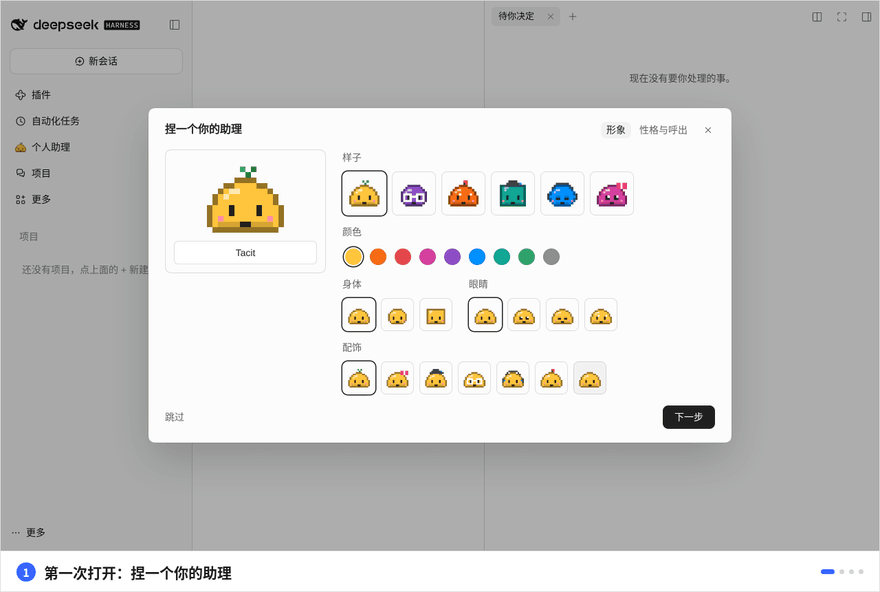
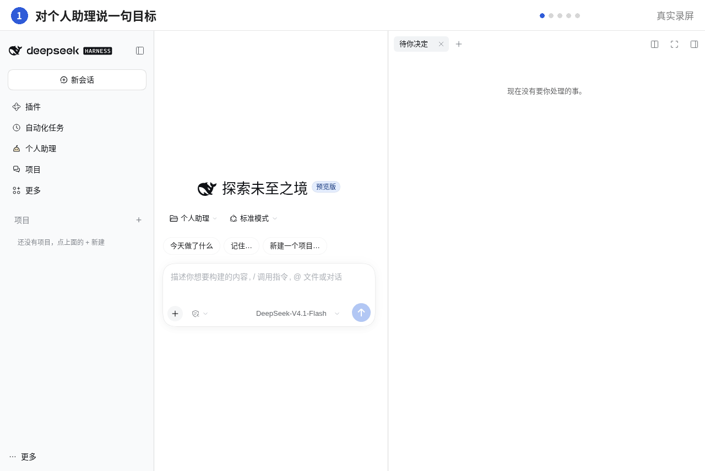
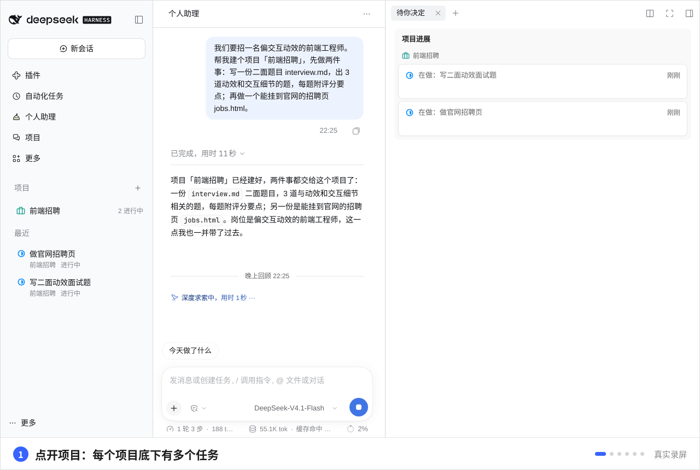
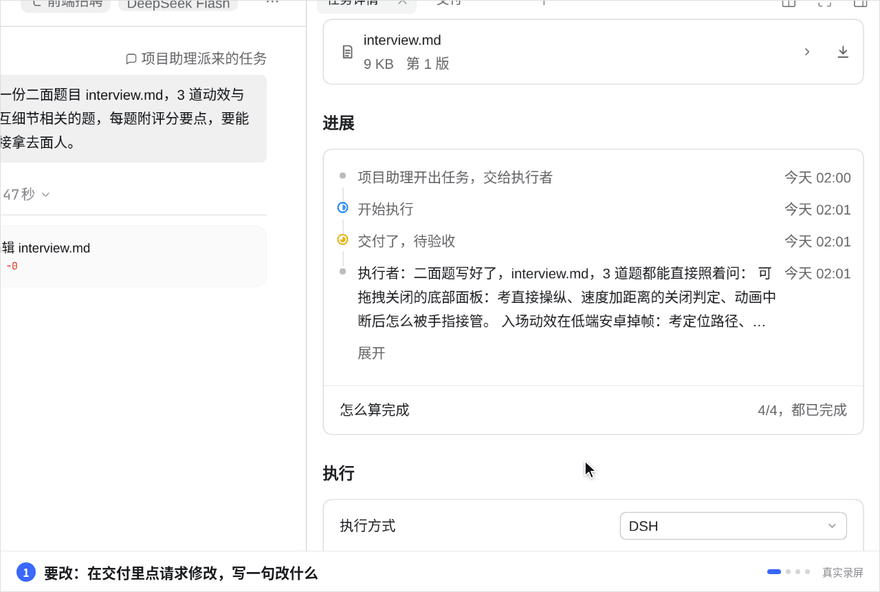
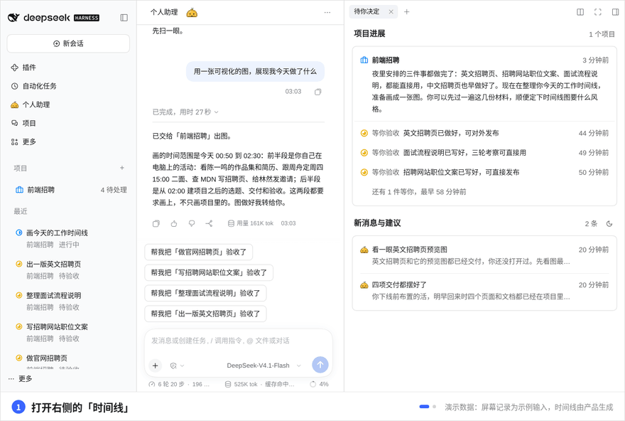
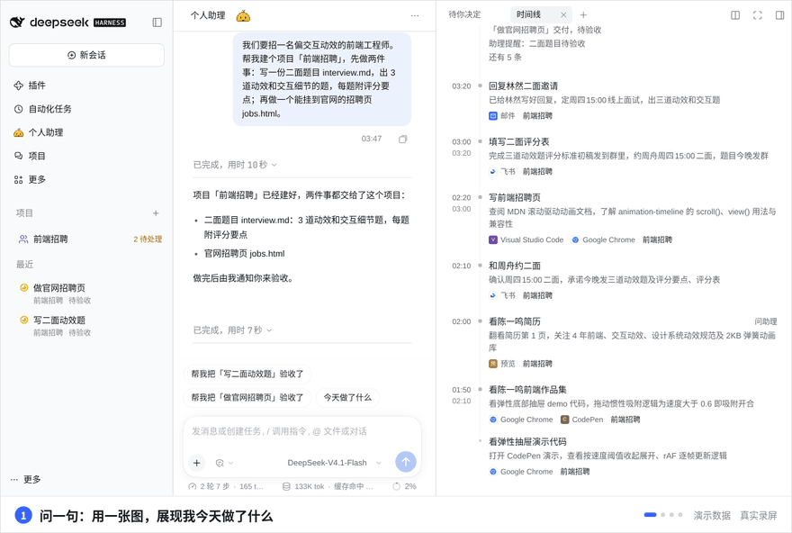
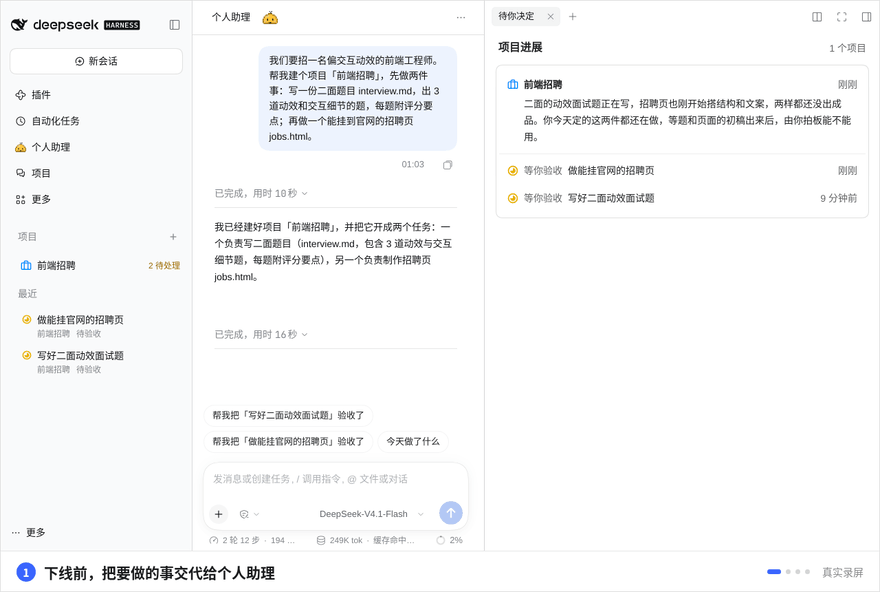
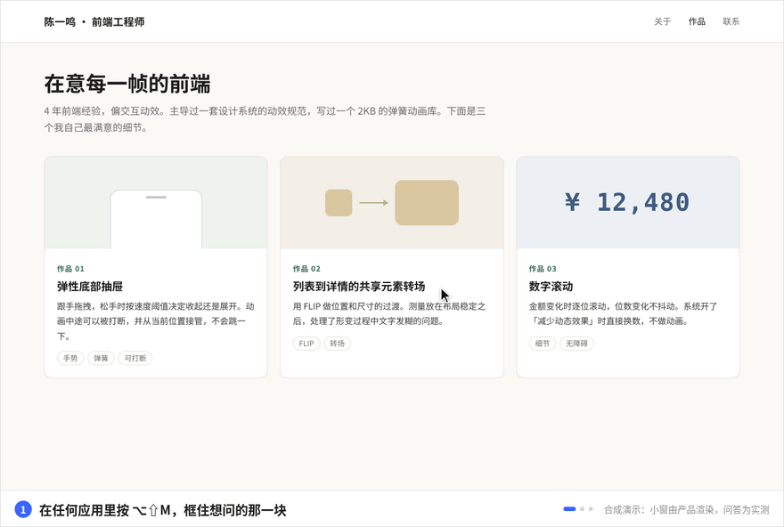

# Getting started with DSH-projects

Ten minutes: install DSH-projects, make your own personal assistant, hand it a first job, and accept what comes back. Each step says how to turn the thing on and how to use it. The interface is in Chinese for now, so the names on screen are given in Chinese.

> The pictures show the interface in development (pixel avatar, card-style 待你决定 board, asking with a screenshot). That code is not in this repository or on npm yet; what you install today, `preview.1`, is the previous version.

## What you need

| Required | Notes |
| --- | --- |
| DeepSeek Harness 0.2.x | DSH-projects is a plugin for it and uses its Web profile. If you don't have it: `npm install -g @deepseek-ai/dsh`. Tested on 0.2.1. |
| Node 24 or later | Runs the plugin and the unit tests. |

Optional:

- The Claude Code or Codex command line. With either installed, a task can be handed to it to execute.
- The Feishu command line (lark-cli). Installed and authorised, it lets the assistant read your Feishu messages, read-only.

The model follows your DeepSeek Harness configuration. To use another OpenAI-compatible gateway, add it to the profile's `cordis.patch.yml` after the pattern in `plugin/qa/provider-template.yml`.

## 1. Set up your assistant

The personal assistant is who you talk to in DSH-projects: you give it goals, and it brings back progress and the things that need your decision.

**Install.** One command adds the plugin, the next starts it:

```sh
dsh plugin --profile web add deepseek-harness-projects-plugin@preview
dsh --profile web        # start it and open the address it prints
```

<details>
<summary>Install from source</summary>

```sh
git clone https://github.com/hovocope135-tech/DSH-projects
cd DSH-projects/plugin
dsh plugin --profile web add "$(pwd)"    # add the plugin to DeepSeek Harness
dsh --profile web
```

</details>

Once it opens, **个人助理** (personal assistant) and **项目** (projects) appear on the left.

**Make your assistant.** The first time, a dialog titled **捏一个你的助理** (make your assistant) opens:

1. Under **形象** (look), pick one of six looks, then change **颜色** (colour), **身体** (body), **眼睛** (eyes) and **配饰** (accessory), and give it a name under **名字**. It is called Tacit by default.
2. Click **下一步** (next). Under **性格与呼出** (traits and shortcut), choose up to three traits, or describe it in one sentence. **呼出** is the shortcut that calls it up from anywhere, ⌥M by default.
3. Click **完成** (done). To do it later, click **跳过** (skip); everything can be changed under **形象与快捷键** in **助理设置** (assistant settings).



This figure is its avatar from then on: in front of 个人助理 on the left, beside the conversation's title, and on the messages it brings to **待你决定** (waiting on you).

**Let it know more.** Optional; it works with nothing connected. All of these are turned on in **助理设置**, and all are read-only:

- **飞书实时读取** (Feishu, live): reads your Feishu messages and documents. It needs the Feishu command line, lark-cli, installed and signed in on this machine. After that you can ask "what did the design group just decide?", and when someone is waiting for your reply it shows up under 待你决定.
- **电脑文件** (computer files): reads the folders you name, or all files. After that you can say "find the job description on my computer and tell me what it asks for on motion".
- **活动与设备** (activity and devices): turns what you do on your computer into a timeline. See step 4.

## 2. Hand everything to your personal assistant

In DSH-projects we encourage you to bring every request straight to the personal assistant. Tell it what you need, and it turns your request into a project and creates that project by itself:

> We're hiring a front-end engineer who leans towards interaction and motion. Create a project 「前端招聘」 and start with two things: write a second-interview question set interview.md, three questions on motion and interaction details, each with scoring notes; then build a hiring page jobs.html that can go on the website.



Say what to do and what counts as good. How to split it into tasks is its call. Where something is unclear, it asks you first.

After you send it, **前端招聘** appears under **项目** on the left, each of the two jobs becomes a task, and both start at once. You don't pick an agent, you don't open a new conversation, and you don't have to watch. When a task is done it shows up under **待你决定** on the right, for you to accept.

Beyond creating projects, you can say these to it directly:

- "Tell the interview-questions task to add one more question on CSS": passes a message to a task.
- "What is still waiting for me?": lists what waits for your acceptance or your decision.
- "Accept the interview questions for me": it first tells you what was delivered, and accepts once you confirm.

## 3. Manage tasks inside a project

Every project has several tasks. Open the project on the left, and **项目任务** (project tasks) on the right lists them with their states. Click a task, and the right side becomes its **任务详情** (task detail).



Each task has its own long-lived context.

- **背景** (background): what this job is, and your own words at the time.
- **产出** (output): the delivered files. Each revision adds a version.
- **读过的文件** (files read): what it read for this job.
- **进展** (progress): every step from opening the task to delivery; what you said along the way is recorded here too.
- **怎么算完成** (what counts as done): the criteria written down when work starts, checked one by one at delivery.
- **执行** (execution): which model this task uses. To change it, choose here.

This context keeps updating as the task moves, so whenever you open it you see the latest. If another model or executor takes over, it reads the same context.

**Accept, or ask for changes.** A finished task stops at **已交付，待验收** (delivered, waiting for acceptance). Open **交付** (delivery): pages, images and documents can be read right there.

- If it's fine, click **验收通过** (accept).
- To change something, click **请求修改** (request changes). The input box is filled with the file name; add what to change. What comes back is **第 2 版** (version 2), and your sentence is recorded under 进展.



## 4. Keep working: context keeps accumulating, and your assistant understands you better and better

**Computer History** (电脑活动记录) turns what you do on your computer into a timeline: one entry per 10 minutes, saying what you were doing and which apps you used.



**Turn it on.** Computer History is off by default and needs Screenpipe on your machine:

1. Open **助理设置**, click **活动与设备**, then **设备与同步** (devices and sync).
2. Tick **同步此设备的观察资料** (sync this device's observations) and click **保存同步设置** (save sync settings).

After that, click + on the right and choose **时间线** (timeline): that is your record of today.

**Use it.** For a daily report, or to recall where something stands, you no longer rely on memory. Ask the personal assistant:

> 用一张可视化的图，展现我今天做了什么 (show me what I did today as a picture)

It first answers from the timeline in text. If you want the picture, reply 「做成一页网页」 (make it a web page): it hands today's data to a project, and a page you can open directly comes back.



The top of the timeline also has a few ready-made questions, such as 「今天做了哪些事，各到哪一步了？」 (what did I work on today, and where does each stand?). One click asks it.

It remembers your habits too. Say 「记住：我看东西习惯先看结论」 (remember: I read the conclusion first), and every conversation after that follows it. Everything it has remembered is under **记忆** (memory) in 助理设置, each with your own words, and you can edit or forget any of them.

## 5. Come back later

After you go offline, what you handed over keeps getting done. At night the personal assistant also goes over the day and picks out what is worth your attention. In the morning you don't scroll through conversations; **待你决定** is enough.

Before you go offline, tell Tacit what to do:

> I'm going offline and will check in the morning. Finish these three things overnight: an English version of the hiring page, jobs-en.html; a job description for the hiring site, jd.md; and a note on the interview process, process.md, saying what the first, second and final interviews each look at.

When you come back, open **待你决定** on the right:

- **项目进展** (project progress): one paragraph per active project, saying where it stands. Each row under it is one thing waiting for your acceptance or your decision; click a row to open that task.
- **新消息与建议** (messages and suggestions): what Tacit left for you overnight, three at most: one thing that could be done, one thing worth a look, one reminder. Click one and a sentence is written into the input box. Edit it, then send.



You can also just ask it 「夜里做了什么」 (what happened overnight). It gives the conclusion first, then the details.

At night it only reads: it sends no messages for you, changes no files and opens no tasks. Without a word from you it makes no decisions and accepts nothing.

## 6. Frame a piece of the screen and ask

You see something in another app and want to ask about it. No switching back, no copy and paste: frame that piece of the screen and ask the personal assistant. It knows your projects and tasks, and the answer comes with that context.

Say you are looking at a candidate's portfolio. Frame one of the works and ask:

> 按我们的二面题目，这位候选人该重点追问哪一题？ (going by our second-interview questions, which one should we press this candidate on?)



**Turn it on.** Asking with a screenshot works on macOS for now, through a small Mac helper. The helper is not in this repository yet, so it cannot be installed today.

**Use it.**

1. In any app, press ⌥⇧M and drag over the piece you want to ask about.
2. A small window opens by the pointer with the capture in it. Type a sentence where it says 「问个人助理…」 and press Return.
3. The answer appears in the same window, and you can keep asking. Press esc, or ⌥⇧M again, to close it.

The same exchange also stays in the personal assistant's conversation, so you can continue on the page.

## Later on

**Switching the executor.** 任务详情 → 「执行」 → 「执行方式」 switches a task between DeepSeek Harness, Claude Code and Codex; the model can be changed separately. After a switch, what you type in the task's own conversation goes to the new executor. To do the work yourself, click 「我来接手」 (I'll take over), and 「交还」 (hand back) when you are done. Note: Claude Code and Codex run as executors without permission prompts or a sandbox; they can read and write whatever your OS user can.

**Assistants and models.** 助理设置 → 高级 → 助理与模型. One page per assistant: when it wakes, what it reads each turn, which model it uses. A project's model strategy can be written in one sentence.

**Every run is visible.** The developer view (开发者视图) keeps every time the assistant was woken: what woke it, the steps in order, which step failed, and the result.

## When something goes wrong

| What you see | What to do |
| --- | --- |
| The page says it can't reach the service and is reconnecting | The service stopped or is restarting. When it is back the page reconnects by itself; you don't sign in again. |
| A task stopped at failed | Open the task and read the last progress entry. It is usually a model or network error; tell it to carry on. |
| Nothing happens after switching to Codex | Codex has to be logged in on this machine first. Without a login it reports an error and stops. |
| After switching to Codex or Claude Code it says an environment variable is missing | DSH-projects starts outside executors with only the basic environment variables plus those beginning with `ANTHROPIC_`, `CLAUDE_`, `OPENAI_` and `CODEX_`, so that unrelated keys are not handed over. If the executor's model key sits under another name it cannot read it: use one of these prefixes, or let the executor use its own login. |
| You want another model gateway | See the last line of What you need. |

## Where the data lives

Everything stays on the machine that runs it. Projects and tasks are an event log; Feishu and computer files are read-only connections that read only what you allow. The model key stays on that machine and never enters the repository. Deleting a project moves it to the trash, and it can be restored at any time.
